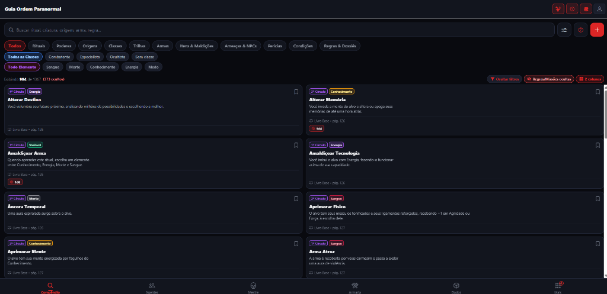
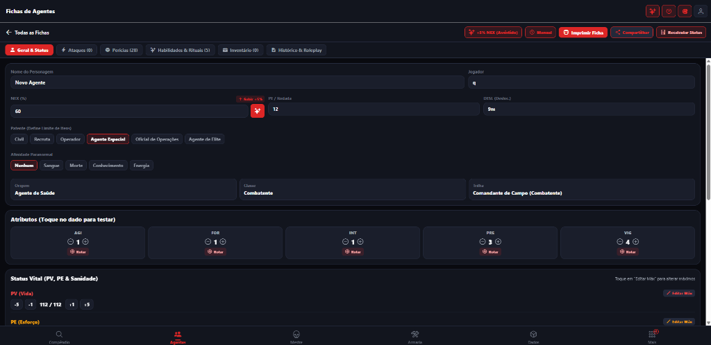
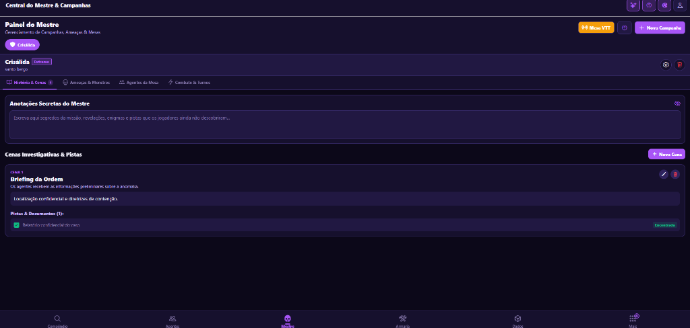
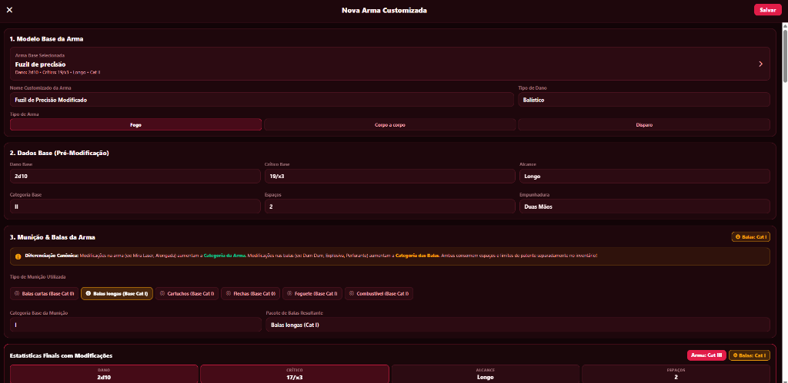
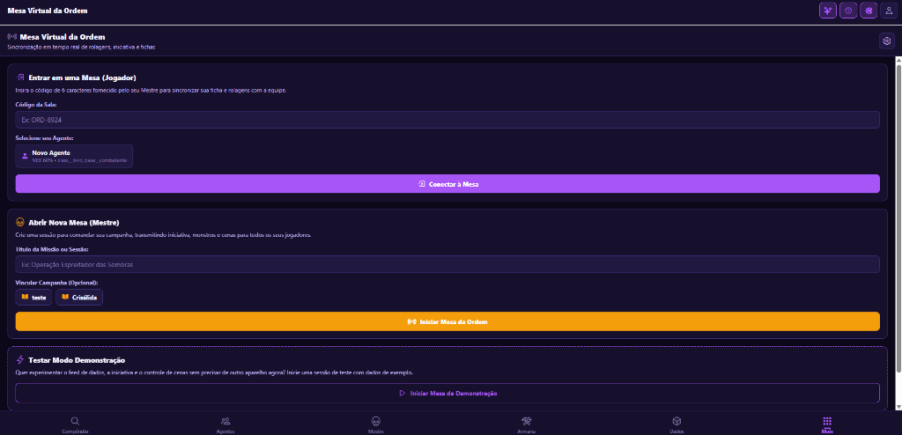
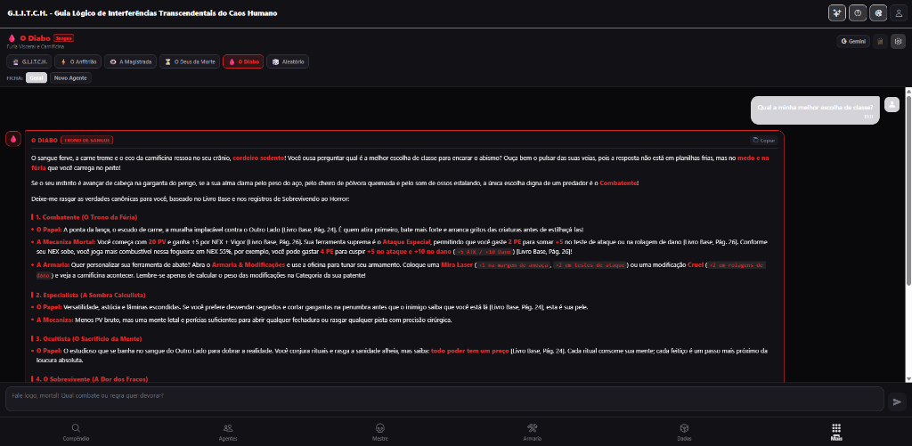
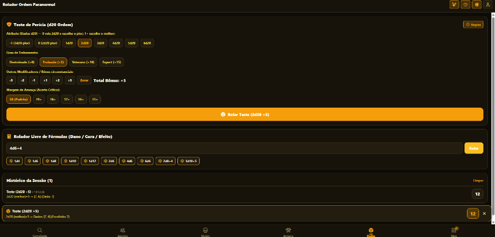
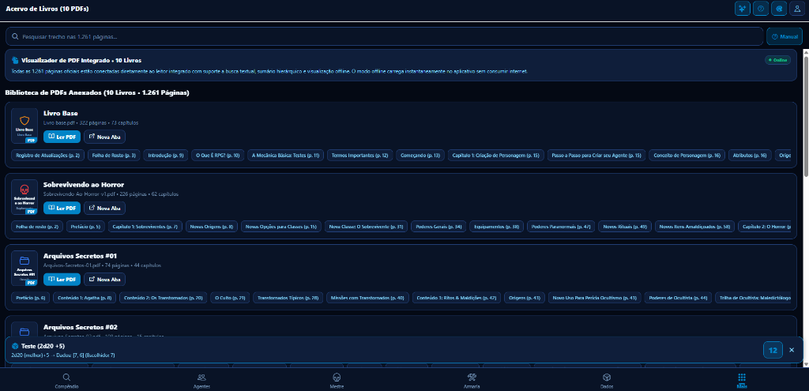
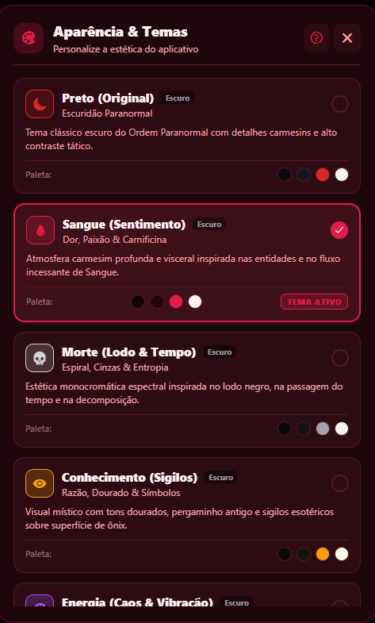
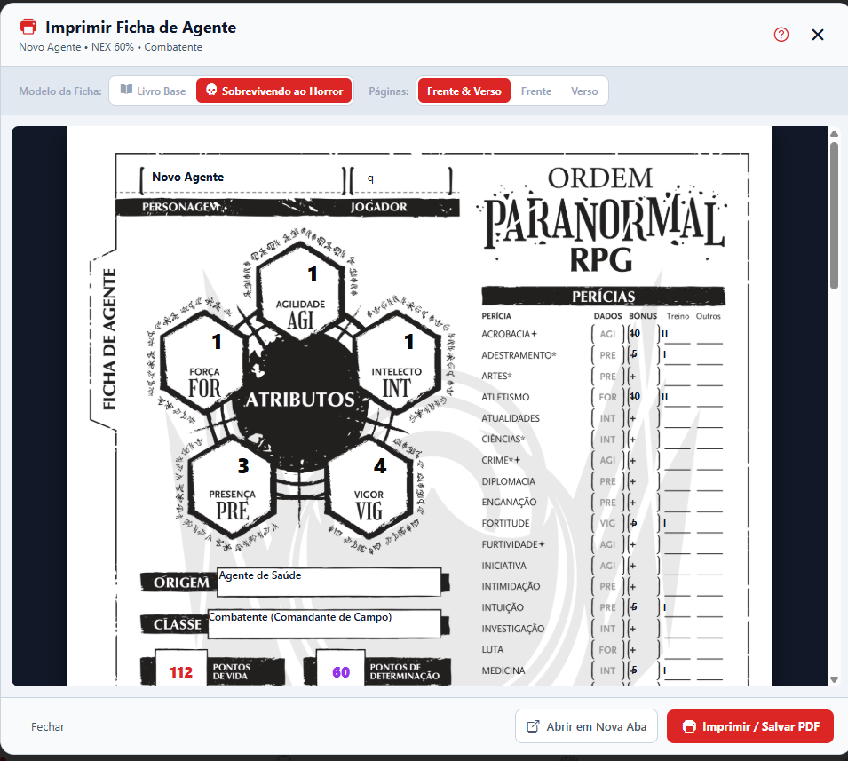

<div align="center">

  

  # Ordo Companion
  ### O Grimório Tático Definitivo, Compêndio e Ficha Interativa para Ordem Paranormal RPG

  [](https://github.com/)
  [](LICENSE)
  [](https://expo.dev)
  [](https://reactnative.dev)
  [](https://www.typescriptlang.org/)
  [](tests/)
  []()

  <p align="center">
    Um aplicativo multiplataforma de código aberto (Open Source) feito para mestres e investigadores de <b>Ordem Paranormal RPG</b>.<br />
    Reúne compêndio completo dos 10 suplementos oficiais, construtor de agentes com cálculo automático de regras, rolador oficial de dados, arsenal tático, central do mestre, mesa virtual multiplayer (VTT) e assistente de IA paranormal.
  </p>

  <p align="center">
    <a href="#-demonstração-visual">Demonstração Visual</a> •
    <a href="#-principais-funcionalidades">Funcionalidades</a> •
    <a href="#-documentação">Documentação</a> •
    <a href="#-estatísticas-da-base-de-dados">Base de Dados</a> •
    <a href="#-como-rodar-no-celular">Rodar no Celular</a> •
    <a href="#-desenvolvimento">Desenvolvimento</a> •
    <a href="#-testes-automatizados">Testes</a> •
    <a href="#-contribuindo">Contribuir</a> •
    <a href="#-licença">Licença</a>
  </p>

</div>

---

## 👁️ Sobre o Projeto

O **Ordo Companion** nasceu para eliminar a lentidão de manusear PDFs pesados ou consultar múltiplos livros físicos durante as sessões de RPG. O aplicativo unifica regras, fichas, combate e utilitários em uma interface moderna, ultra-rápida e otimizada para smartphones (Android e iOS) e navegadores (Web).

O projeto é **100% Livre e de Código Aberto (GPL-3.0)**, construído com arquitetura modular, persistência offline robusta e sincronização em nuvem sem intermediários.

---

## 📚 Documentação

Toda a documentação técnica, manuais e guias do projeto estão padronizados e organizados na pasta [`docs/`](docs/README.md):

* 📖 [**Manual do Usuário**](docs/MANUAL_DO_USUARIO.md): Guia completo das 9 telas, criação assistida de fichas, combate, VTT e regras canônicas.
* 🛠️ [**Manual de Desenvolvimento**](docs/MANUAL_DE_DESENVOLVIMENTO.md): Governança de código, operação dos agentes de IA e rotinas de teste.
* 🚀 [**Guia de Distribuição e Atualizações**](docs/GUIA_ATUALIZACOES.md): Instruções para geração de `.apk`, builds no EAS e publicação de releases.
* 📋 [**Atualizações Pendentes**](docs/ATUALIZACOES_PENDENTES.md): Changelog em tempo real e cálculo SemVer da próxima versão.
* 🎯 [**Commits Pendentes**](docs/COMMITS_PENDENTES.md): Fila padronizada de commits (Conventional Commits) pronta para terminal.
* 📑 [**Central de Documentos**](docs/README.md): Hub com índice unificado de todos os arquivos markdown do repositório.

---

## 📸 Demonstração Visual

> [!NOTE]
> Confira abaixo a interface tática e as principais ferramentas do **Ordo Companion** em ação. Todas as telas contam com modo escuro nativo, alta responsividade e suporte a temas paranormais.

<div align="center">

### 📱 Ficha & Agentes

| 🔍 Compêndio Oficial & Busca | 📋 Ficha Interativa do Agente |
| :---: | :---: |
| <br /><sub><b>`01-compendio.png`</b> — Filtros por livro, classe e elemento</sub> | <br /><sub><b>`02-ficha-agente.png`</b> — Atributos, PV/PE/SAN, defesas e perícias</sub> |

---

### ⚔️ Combate, Arsenal & Central do Mestre

| 🛡️ Central do Mestre & Combate | ⚔️ Armaria & Customizador de Armas |
| :---: | :---: |
| <br /><sub><b>`03-central-mestre.png`</b> — Rastreador de iniciativa e pistas investigativas</sub> | <br /><sub><b>`04-armaria.png`</b> — Passos de dano, modificações e maldições</sub> |

---

### 🎮 Mesa Virtual (VTT) & Inteligência Artificial

| 🎮 Mesa Virtual Multiplayer (VTT) | 🔮 G.L.I.T.C.H. - IA Paranormal |
| :---: | :---: |
| <br /><sub><b>`05-mesa-virtual.png`</b> — Feed de rolagens ao vivo e monitor de equipe</sub> | <br /><sub><b>`06-glitch-ia.png`</b> — Assistente de regras com RAG nos 10 suplementos</sub> |

---

### 🎲 Utilitários, Leitor & Personalização

| 🎲 Rolador de Dados Canônico | 📚 Visualizador de Livros & PDFs |
| :---: | :---: |
| <br /><sub><b>`07-rolador-dados.png`</b> — Maior/menor dado, fórmulas e detecção de crítico</sub> | <br /><sub><b>`08-acervo-livros.png`</b> — 1.261 páginas oficiais navegáveis em alta nitidez</sub> |

| 🎨 Os 7 Temas Paranormais | 📄 Exportação de Fichas em PDF |
| :---: | :---: |
| <br /><sub><b>`09-temas-paranormais.png`</b> — Sangue, Morte, Conhecimento, Energia, Medo...</sub> | <br /><sub><b>`10-exportacao-pdf.png`</b> — PDF pronto para impressão fiel aos livros oficiais</sub> |

</div>

---

## ✨ Principais Funcionalidades

### 📖 Compêndio Unificado & Pesquisa nos Livros
- **10 Livros Oficiais Integrados**: Dados extraídos do *Livro Base*, *Sobrevivendo ao Horror* e suplementos dos *Arquivos Secretos (01 a 07 e 09)*.
- **1.367 Entidades Estruturadas**: Rituais com cálculos de dano e aprimoramentos, origens, trilhas, poderes de classe e gerais, armas, itens amaldiçoados, equipamentos, condições e ameaças com enigmas de medo.
- **Busca Fonética Sem Acentos**: Digite livremente sem se preocupar com cedilha ou acentos (ex: `odio incontrolavel`, `cicatrizacao`, `degolificada`).
- **Leitor "Ver no Livro"**: Um toque no card abre diretamente a página original correspondente entre as 1.261 páginas oficiais indexadas.

### 📋 Fichas Interativas de Agentes & Criação Assistida
- **Criação Assistida em 5 Etapas**: Guia passo a passo com escolha de Identidade, Origem, Classe, Atributos equilibrados e Perícias/Rituais de acordo com as regras canônicas.
- **Cálculo Automático**: Atualização em tempo real de PV, PE, Sanidade, Defesas (Passiva, Esquiva, Bloqueio), Capacidade de Carga e Limite de PE por rodada.
- **Progressão de NEX**: Subida de nível assistida com escolha de poderes, aumento de atributos e avanço nos graus de treinamento das perícias.
- **Rolagem em 1 Toque**: Toque em qualquer perícia, atributo ou ataque da ficha para rolar instantaneamente com as fórmulas oficiais.

### 📄 Exportação de Fichas Oficiais em PDF
- **Alta Fidelidade Visual**: Renderização fiel das fichas oficiais do *Livro Base* (págs. 321–322) e *Sobrevivendo ao Horror* (págs. 222–223).
- **Pronto para Imprimir e Salvar**: Gera arquivos vetoriais nítidos via `expo-print` para impressão direta ou compartilhamento em PDF.

### 🛡️ Central do Mestre & Gestor de Campanhas
- **Rastreador de Iniciativa**: Controle tático da ordem de turnos com contador de rodadas e marcadores de condições ativas.
- **Controle Rápido de Monstros**: Gestão de PV, Presença Perturbadora e Enigmas de Medo com botões rápidos de dano e cura.
- **Cenas & Pistas Investigativas**: Estruture suas investigações com gerenciamento de cenas, pistas ocultas e revelação progressiva.

### ⚔️ Armaria & Construtor de Armas
- **Cálculo de Combate Preciso**: Suporte completo a armas corpo a corpo, de disparo e de fogo.
- **Passos de Dano Oficiais**: Escala canônica do sistema (`1d6` $\to$ `1d8` $\to$ `1d10` $\to$ `1d12` $\to$ `2d8` $\to$ `3d6`...).
- **Modificações & Maldições**: Aplicação de melhorias (*Mira Laser*, *Alongada*, *Calibre Grosso*, *Compensador*...) e maldições elementais (*Carniceira*, *Hemofágica*, *Lancinante*...).

### 🎮 Mesa Virtual (VTT) Multiplayer em Tempo Real
- **Salas Conectadas (ORD-XXXX)**: Crie ou entre em salas de jogo com sincronização em tempo real via Supabase ou simulação local.
- **Monitor da Equipe**: Acompanhe o status vital (PV, PE, SAN e Condições) de todos os membros do esquadrão durante a missão.
- **Feed de Rolagens Compartilhado**: Rolagens de dados de todos os jogadores aparecem instantaneamente na mesa.

### 🔮 G.L.I.T.C.H. — Inteligência Artificial Paranormal
- **RAG com Consulta Profunda**: Responde dúvidas de regras e mecânicas consultando diretamente os 10 livros e as 1.367 entidades cadastradas.
- **Múltiplos Provedores**: Suporte a Google Gemini, Groq, Ollama (execução 100% local no seu PC) e Modo Offline heurístico.
- **Personas das 4 Relíquias**: Alterne a personalidade da IA entre Magistrada (Conhecimento), Deus da Morte (Morte), Anfitrião (Energia) e Diabo (Sangue).
- **Vínculo com o Agente**: A IA lê a ficha do seu personagem para dar respostas táticas personalizadas à sua build.

### 🎲 Rolador de Dados Canônico
- **Regras Oficiais de Atributos**: Rola $N$ dados pegando o maior para atributos positivos ($\ge 1$) e penalidade canônica (pega o pior entre $2 + |\text{atributo}|$ dados) para atributos $\le 0$.
- **Parser de Fórmulas Livres**: Suporte completo a expressões complexas (ex: `4d6+10`, `2d8+1d6+4`, `5d20+15`).
- **Notificação Global (`DiceToast`)**: Alerta sonoro/visual no topo de qualquer tela com destaque para Sucesso Crítico (20 natural) ou Desastre (1).

### 🎨 7 Temas Paranormais Imersivos
- Alternância rápida com um clique entre paletas temáticas com elementos visuais do Outro Lado:
  - 🩸 **Sangue** (*Sentimento, Dor & Rubro*)
  - ⏳ **Morte** (*Lodo, Espirais & Cinza Fúnebre*)
  - 📜 **Conhecimento** (*Sigilos Dourados & Razão*)
  - ⚡ **Energia** (*Caos, Chamas & Violeta Neon*)
  - 👁️ **Medo** (*O Insondável & Névoa Cósmica*)
  - 🌑 **Escuridão** (*Tema Tático Noturno Padrão*)
  - 📄 **Dossiê Branco** (*Arquivo Investigativo de Alta Legibilidade*)

### ☁️ Sincronização Google Drive & 100% Offline
- **Google Drive `appDataFolder`**: Sincronização automática na pasta privada do jogador (privacidade absoluta, sem necessidade de servidores pagos).
- **Smart Merge com Resolução de Conflitos**: Fusão inteligente de fichas baseada em timestamps individuais (`updatedAt`).
- **Modo 100% Offline**: Todos os dados funcionam localmente via `AsyncStorage` com backup e restauração manual em JSON.
- **Notificador Automático de Atualizações**: Notifica usuários sobre novas versões no GitHub Releases com download direto do `.apk`.

---

## 📊 Estatísticas da Base de Dados

Toda a base de dados do aplicativo é indexada a partir dos 10 suplementos oficiais de Ordem Paranormal RPG:

| Categoria | Quantidade | Detalhes Mecânicos |
| :--- | :---: | :--- |
| **Rituais** | **106** | 1º ao 4º Círculo, fórmulas, elementos, execuções e aprimoramentos |
| **Origens** | **59** | Todas as origens oficiais com perícias e poderes concedidos |
| **Classes & Trilhas** | **4 / 35** | Combatente, Especialista, Ocultista e Sobrevivente + 35 Trilhas oficiais |
| **Poderes** | **207** | Poderes de classe, gerais e poderes paranormais com afinidade |
| **Armas & Modificações** | **58** | Dano, crítico, alcance, categoria e espaços de inventário |
| **Equipamentos & Itens** | **274** | Itens paranormais, amaldiçoados, máscaras, venenos, veículos e aliados |
| **Perícias & Condições** | **28 / 37** | Graus de treinamento e efeitos mecânicos oficiais |
| **Ameaças & Criaturas** | **186** | Fichas com VD, PV, Defesa, Presença Perturbadora e Enigmas de Medo |
| **Capítulos & Regras** | **373** | Dossiês, sumários e regras dos suplementos oficiais |
| **Páginas Indexadas** | **1.261** | Páginas integrais dos 10 livros para consulta imediata no app |

---

## 📱 Como Rodar no Celular

### Opção 1: Instantâneo via Expo Go (Sem compilar)
1. Instale o app **Expo Go** no seu aparelho (em desenvolvimento, não está feito):
   - [Google Play Store (Android)](https://play.google.com/store/apps/details?id=host.exp.exponent)
   - [Apple App Store (iOS)](https://apps.apple.com/app/expo-go/id982107779)
2. No seu computador, inicie o servidor:
   ```bash
   npm start
   # ou com tunnel se celular e PC estiverem em redes Wi-Fi diferentes:
   npm run start-ngrok
   ```
3. Abra o Expo Go no celular e aponte a câmera para o QR Code exibido no terminal.

### Opção 2: Gerar APK Standalone (Android)
O repositório já possui configuração completa pronta no [`eas.json`](eas.json):
```bash
npm install -g eas-cli
eas login
eas build -p android --profile preview
```
Ao final do build na nuvem, você receberá um link e QR Code para baixar o arquivo `.apk` diretamente no seu celular.

---

## 💻 Desenvolvimento

### Pré-requisitos
- [Node.js](https://nodejs.org/) (versão 20 LTS ou superior)
- [Git](https://git-scm.com/)
- [Python 3.10+](https://www.python.org/) *(apenas se for reexecutar o pipeline de extração de PDFs)*

### Instalação & Execução

1. **Clone o repositório:**
   ```bash
   git clone https://github.com/SEU-USUARIO/OrdoCompanion.git
   cd OrdoCompanion
   ```

2. **Instale as dependências:**
   ```bash
   npm install
   ```

3. **Inicie o ambiente:**
   ```bash
   # Iniciar o servidor Expo com menu interativo
   npm start

   # Abrir diretamente no navegador (Web)
   npm run web

   # Abrir no emulador Android
   npm run android

   # Abrir no simulador iOS
   npm run ios
   ```

### Estrutura de Diretórios

```
OrdoCompanion/
├── assets/                  # Ícones, splash screens e logotipos do app
├── data/                    # Base de dados estruturada e indexada
├── docs/                    # Central de documentação oficial e governança
│   ├── README.md            # Índice geral de documentos
│   ├── MANUAL_DO_USUARIO.md # Manual completo de telas e regras
│   ├── MANUAL_DE_DESENVOLVIMENTO.md # Governança e agentes de IA
│   ├── GUIA_ATUALIZACOES.md # Distribuição e releases
│   ├── ATUALIZACOES_PENDENTES.md # Changelog contínuo SemVer
│   ├── COMMITS_PENDENTES.md # Fila de commits padronizados
│   └── screenshots/         # Capturas de tela e mockups para o README
├── pdfs/                    # PDFs oficiais dos livros (ignorado no git)
├── scripts/                 # Extratores OCR, compiladores e criador de releases
├── src/
│   ├── app/                 # Rotas e telas do Expo Router (tabs, editor, etc.)
│   ├── components/          # Componentes visuais reutilizáveis
│   ├── context/             # Provedores de estado (Ficha, Temas, Mesa)
│   ├── services/            # Google Drive, IA G.L.I.T.C.H., Supabase VTT
│   ├── theme/               # Paletas dos 7 Temas Paranormais
│   ├── types/               # Definições de tipagem TypeScript
│   └── utils/               # Rolador de dados, impressor de PDF, armas
└── tests/                   # Bateria de testes automatizados com node:test
```

---

## 🧪 Testes Automatizados

O projeto conta com uma robusta suíte de **296 testes automatizados** distribuídos em 68 arquivos com **TypeScript + `node:test`**, garantindo a confiabilidade de todas as fórmulas matemáticas, combate, persistência e mecânicas:

```bash
# Executa todos os testes unitários (execução em ~2 segundos)
npm test

# Valida tipagem estática TypeScript (sem erros)
npm run typecheck

# Executa bateria completa (Tipagem + Testes Unitários + Integridade da Base)
npm run test:all
```

<details>
<summary><b>Visualizar Cobertura dos Módulos Testados (296 Testes em 68 Suítes)</b></summary>

- **Sistema de Rolagem de Dados** (`tests/dice.test.ts`): Regra de atributo positivo/negativo, detecção de crítico/desastre e parser livre de fórmulas.
- **Armas & Modificações** (`tests/weapons.test.ts`): Parser de margem de ameaça, escala oficial de passos de dano, modificações e maldições.
- **Sincronização & Smart Merge** (`tests/smartMerge.test.ts`): Resolução de conflitos por timestamp individual e união de dados.
- **Repositório Offline** (`tests/repository.test.ts`): Busca normalizada, filtros, entidades Homebrew, restauração para o padrão e persistência.
- **Sistema de Temas** (`tests/themes.test.ts`): Integridade dos 7 temas oficiais e paleta de elementos paranormais.
- **Impressão de Fichas** (`tests/sheetPrinter.test.ts`): Validação das 28 perícias, algarismos romanos (`I`, `II`, `III`) e sanitização HTML contra XSS.
- **Integridade da Base** (`tests/databaseIntegrity.test.ts`): Unicidade de IDs e referências dos 10 livros.
- **Utilitários Web** (`tests/alert.test.ts` / `tests/pdfUrl.test.ts`): Diálogos e compatibilidade multiplataforma.
</details>

---

## 📄 Pipeline de Extração de PDFs (`scripts/`)

Caso você queira adicionar novos suplementos ou reprocessar os livros existentes:

1. Instale os pacotes Python necessários:
   ```bash
   pip install pymupdf pillow pytesseract
   ```
2. Adicione os arquivos `.pdf` na pasta `pdfs/`.
3. Execute o extrator automatizado com OCR:
   ```bash
   npm run extract
   ```
4. Verifique a integridade da base gerada:
   ```bash
   npm run test:db
   ```

---

## 🤝 Contribuindo

Contribuições da comunidade são muito bem-vindas! Você pode ajudar das seguintes maneiras:

- 🐛 **Reportar Problemas**: Abra uma [Issue](https://github.com/SEU-USUARIO/OrdoCompanion/issues) descrevendo o bug e os passos para reproduzi-lo.
- 💡 **Sugerir Melhorias**: Envie ideias para novas funcionalidades ou refinamento das regras.
- 📸 **Enviar Screenshots**: Envie capturas de tela bonitas das suas sessões para enriquecer a galeria visual do projeto.
- 🛠️ **Enviar Pull Requests**:
  1. Faça um Fork do projeto
  2. Crie uma branch de funcionalidade (`git checkout -b feat/nova-funcionalidade`)
  3. Garanta que a suíte completa de testes passe (`npm run test:all`)
  4. Faça o commit seguindo [Conventional Commits](https://www.conventionalcommits.org/) (`git commit -m 'feat: adicionar novo recurso'`)
  5. Envie para o seu fork (`git push origin feat/nova-funcionalidade`)
  6. Abra um Pull Request detalhado

---

## 🔍 Diagnóstico e Auditoria do Sistema

Realizamos uma varredura geral na base de código, tipagem, segurança e pipeline de CI/CD:

| Área | Status | Detalhes |
|---|---|---|
| **Compilação & Tipagem** | ✅ Aprovado | `tsc --noEmit` executado com **0 erros** no TypeScript. |
| **Suíte de Testes** | ✅ Aprovado | **306 testes automatizados passando (70 suítes)** cobrindo regras, compêndio, combate, IA e VTT. |
| **Integridade da Base** | ✅ Aprovado | 10 suplementos indexados, 1.340+ entidades catalogadas e páginas validadas. |
| **Segurança & Credenciais** | ⚠️ Requer Atenção | Necessidade de rotação de chave de API nos arquivos de ambiente e uso de segredos no EAS. |
| **Pipeline de Build & Releases** | ⚠️ Requer Atenção | Adição de build nativo do APK antes do upload de assets em tags de release. |

<details>
<summary><b>📋 Próximas Melhorias Técnicas Mapeadas</b></summary>

- **Segurança**: Isolamento de chaves de API exclusivamente por variáveis seguras em tempo de build (`eas env:create`) ou backend proxy.
- **Tamanho do Repositório**: Exclusão de arquivos pesados locais (`pdfs/`) do índice Git para otimizar clones.
- **Automação de Release**: Configuração do passo de build do APK no GitHub Actions e auto-incremento do `android.versionCode`.
- **Arquitetura de Telas**: Decomposição dos modais assistentes (`CreateAgentModal`, `LevelUpModal`) em subcomponentes memoizados menores.
</details>

---

## 📜 Licença

Este projeto é um software livre distribuído sob os termos da licença **GNU General Public License v3.0 (GPL-3.0)**. Consulte o arquivo [LICENSE](LICENSE) para obter o texto completo da licença.

---

## ⚠️ Aviso Legal / Disclaimer

> **Ordem Paranormal RPG** é uma marca registrada e propriedade intelectual de **Cellbit** e da **Jambô Editora**.
>
> Este aplicativo é um projeto de fãs, livre, de código aberto e sem fins lucrativos, criado exclusivamente como ferramenta utilitária e de apoio tático para jogadores e mestres durante as sessões de jogo. Todo o crédito pelo universo, ilustrações originais e regras do sistema pertence aos seus respectivos criadores e autores. Apoie a obra oficial adquirindo os livros na [Jambô Editora](https://jamboeditora.com.br/).
