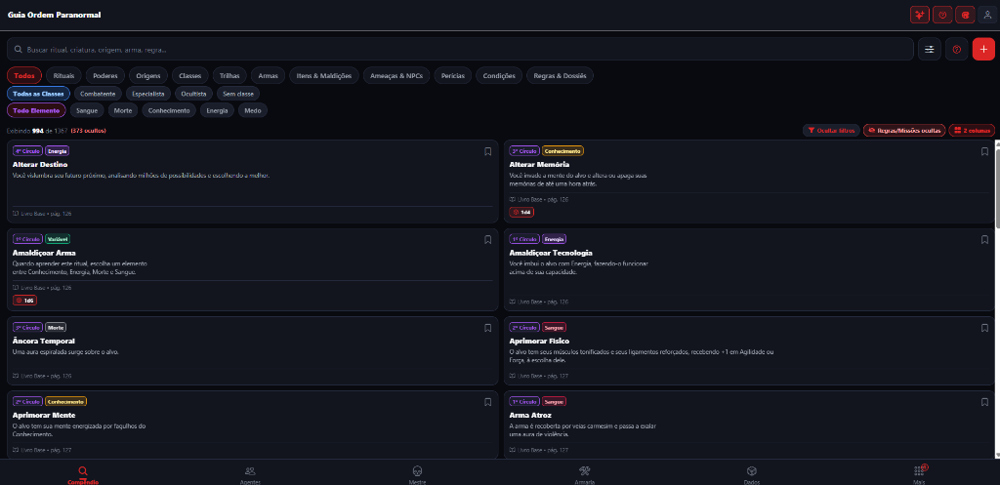
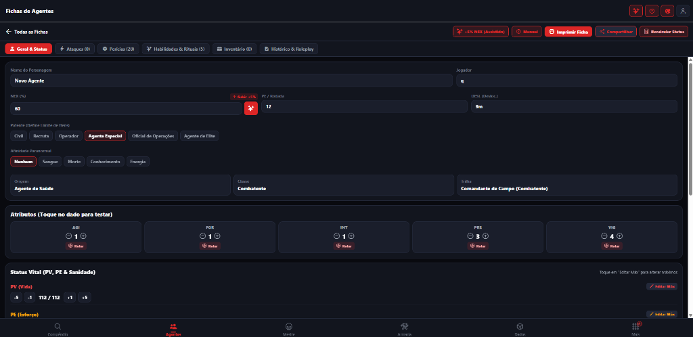
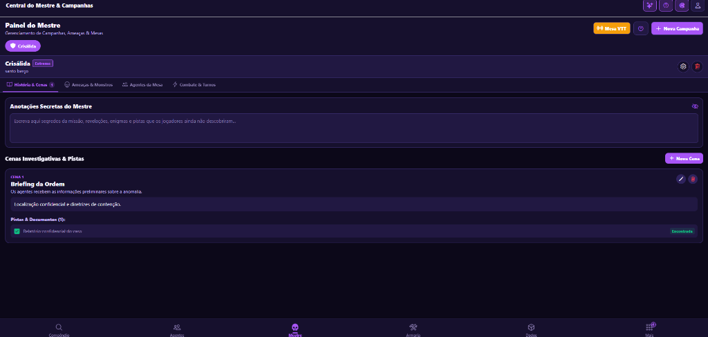
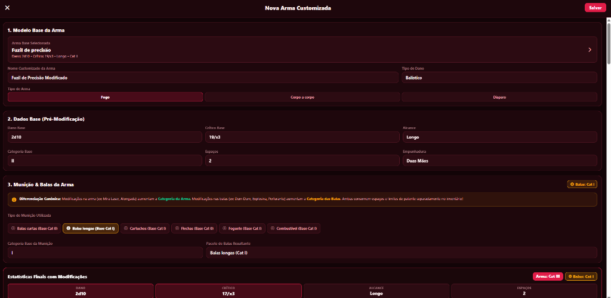
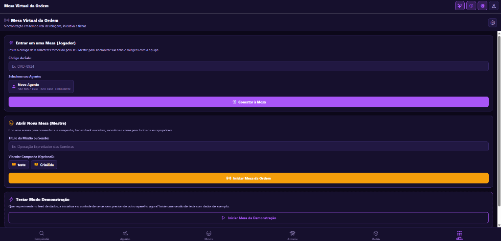
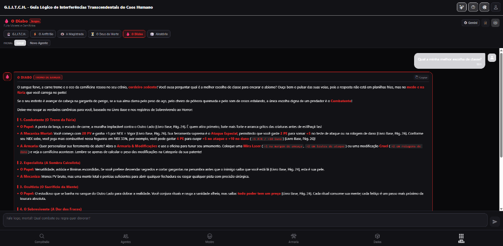
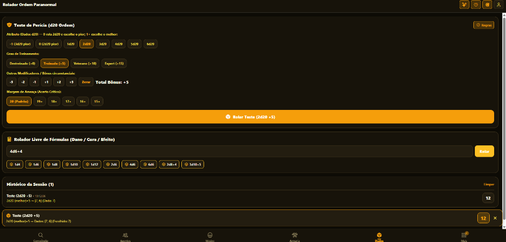
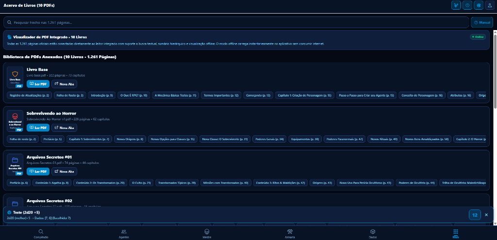
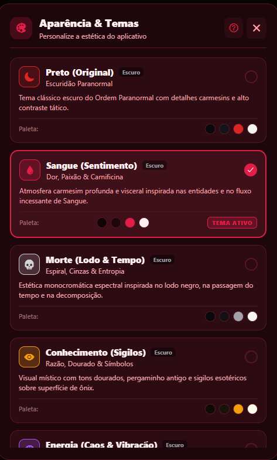
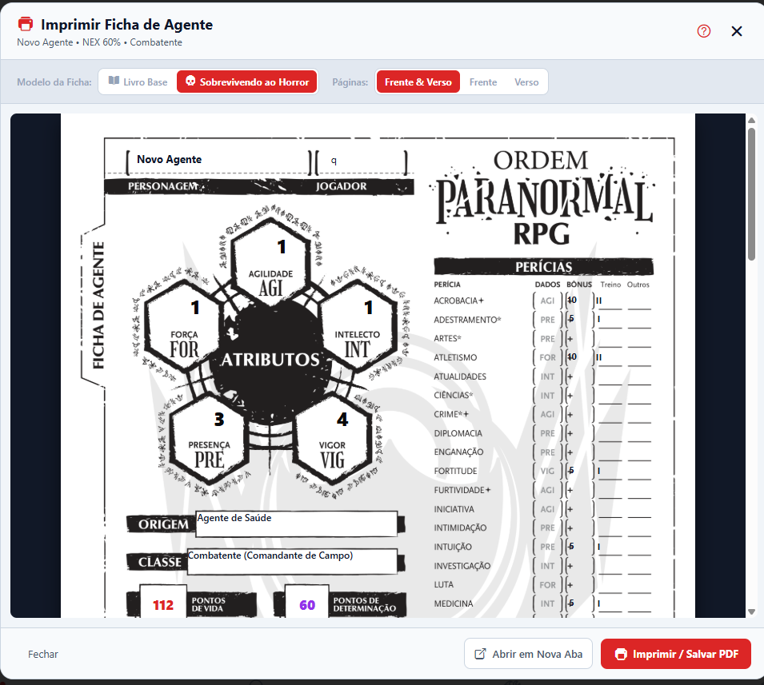

<div align="center">

  

  # Ordo Companion
  ### O Grimório Tático Definitivo, Compêndio e Ficha Interativa para Ordem Paranormal RPG

  [](https://github.com/Lecrepus17/OrdoCompanion)
  [](LICENSE)
  [](https://ordo-companion.expo.app/)
  [](https://github.com/Lecrepus17/OrdoCompanion/releases/latest/download/OrdoCompanion.apk)
  [](https://discord.gg/vPCZzr2wFR)
  [](https://github.com/Lecrepus17/OrdoCompanion/releases/latest)
  [](https://expo.dev)
  [](https://reactnative.dev)
  [](https://www.typescriptlang.org/)
  [%20%7C%20Web-lightgrey.svg)](https://ordo-companion.expo.app/)

  <p align="center">
    Um aplicativo multiplataforma de código aberto (Open Source) feito para mestres e investigadores de <b>Ordem Paranormal RPG</b>.<br />
    Reúne compêndio completo dos 10 suplementos oficiais (Livro Base v1.3 + Sobrevivendo ao Horror + Arquivos Secretos), construtor de agentes com suporte a <b>Pontos de Determinação (PD)</b>, rolador oficial de dados, arsenal tático, central do mestre, criador de ameaças, mesa virtual multiplayer (VTT) e assistente de IA paranormal.
  </p>

  <p align="center">
    <a href="https://ordo-companion.expo.app/"><b>🌐 Abrir na Web / PC</b></a> •
    <a href="https://github.com/Lecrepus17/OrdoCompanion/releases/latest/download/OrdoCompanion.apk"><b>📲 Baixar APK (Android)</b></a> •
    <a href="https://github.com/Lecrepus17/OrdoCompanion/releases/latest"><b>📦 Releases no GitHub</b></a> •
    <a href="https://discord.gg/vPCZzr2wFR"><b>💬 Comunidade Discord</b></a>
  </p>

  <p align="center">
    <a href="#-como-acessar-e-baixar">Acessar & Baixar</a> •
    <a href="#-demonstração-visual">Demonstração Visual</a> •
    <a href="#-principais-funcionalidades">Funcionalidades</a> •
    <a href="#-documentação">Documentação</a> •
    <a href="#-estatísticas-da-base-de-dados">Base de Dados</a> •
    <a href="#-desenvolvimento">Desenvolvimento</a> •
    <a href="#-testes-automatizados">Testes</a> •
    <a href="#-contribuindo">Contribuir</a> •
    <a href="#-licença">Licença</a>
  </p>

</div>

---

## 👁️ Sobre o Projeto

O **Ordo Companion** nasceu para eliminar a lentidão de manusear PDFs pesados ou consultar múltiplos livros físicos durante as sessões de RPG. O aplicativo unifica regras, fichas, combate e utilitários em uma interface moderna, ultra-rápida e otimizada para smartphones (Android), navegadores (Web) e computadores Desktop (Windows, macOS e Linux via PWA).

O projeto é **100% Livre e de Código Aberto (GPL-3.0)**, construído com arquitetura modular, persistência offline robusta e sincronização em nuvem sem intermediários.

---

## 🌐 Como Acessar e Baixar

Você pode usar o **Ordo Companion** imediatamente no navegador, instalá-lo como aplicativo no computador ou baixar o `.apk` oficial no celular Android:

| Plataforma | Link Oficial | Modo de Uso |
| :--- | :--- | :--- |
| 🌐 **Navegador Web (Online)** | [**https://ordo-companion.expo.app/**](https://ordo-companion.expo.app/) | Acesso instantâneo no PC, tablet ou celular com atualização automática pelo servidor |
| 💻 **Aplicativo para PC (Windows, macOS e Linux)** | [**https://ordo-companion.expo.app/**](https://ordo-companion.expo.app/) *(Instalar PWA)* | Janela dedicada na Área de Trabalho / Menu Iniciar com suporte **Offline** |
| 📲 **Android (Download Direto `.apk`)** | [**Baixar `OrdoCompanion.apk` (Última Versão)**](https://github.com/Lecrepus17/OrdoCompanion/releases/latest/download/OrdoCompanion.apk) | Aplicativo nativo standalone com leitor de PDF nativo e armazenamento 100% offline |
| 📦 **Todas as Versões & Notas** | [**GitHub Releases**](https://github.com/Lecrepus17/OrdoCompanion/releases) | Histórico de versões, changelogs detalhados e arquivos de instalação |
| 💬 **Suporte & Comunidade** | [**Servidor Oficial no Discord**](https://discord.gg/vPCZzr2wFR) | Relato de erros (`#erros`), sugestões de melhorias (`#melhorias`) e novidades |

### 📲 Passo a Passo — Instalar no Celular ou Tablet Android (`.apk`)
1. Baixe o arquivo [**`OrdoCompanion.apk`**](https://github.com/Lecrepus17/OrdoCompanion/releases/latest/download/OrdoCompanion.apk) (ou acesse a [página da última Release](https://github.com/Lecrepus17/OrdoCompanion/releases/latest) e toque em `OrdoCompanion.apk` na seção **Assets**).
2. Abra o arquivo baixado nas notificações ou no gerenciador de arquivos do aparelho e confirme em **Instalar** *(caso seja a primeira vez, permita a instalação da fonte do navegador)*.
3. **Para atualizar versões futuras**: basta baixar e instalar o novo `.apk` por cima — todas as suas fichas, campanhas, armas e configurações locais são preservadas!

### 💻 Passo a Passo — Usar na Web ou Instalar no PC (Windows, macOS e Linux)
1. Acesse [**https://ordo-companion.expo.app/**](https://ordo-companion.expo.app/) pelo **Google Chrome**, **Microsoft Edge** ou outro navegador moderno para usar direto na Web.
2. Para instalar como **Aplicativo de Desktop (PWA Offline)**:
   - Clique no ícone de **Instalar aplicativo** (computador com seta) no canto direito da barra de endereços do navegador; **ou**
   - Dentro do app, abra o **Perfil do Usuário** (canto superior direito) ➔ aba **Identidade** ➔ clique em **Instalar Aplicativo no PC**.
3. Para levar suas fichas e campanhas entre o celular e o PC, conecte sua conta na aba **Nuvem (Google Drive)** do Perfil ou utilize os botões de **Exportar / Importar Backup `.json`**.

---

## 📚 Documentação

Toda a documentação técnica, manuais e guias do projeto estão padronizados e organizados na pasta [`docs/`](docs/README.md):

* 📖 [**Manual do Usuário**](docs/MANUAL_DO_USUARIO.md): Guia completo das telas, criação assistida de fichas, combate, VTT e regras canônicas.
* 🛠️ [**Manual de Desenvolvimento**](docs/MANUAL_DE_DESENVOLVIMENTO.md): Governança de código, operação dos agentes de IA e rotinas de teste.
* 🚀 [**Guia de Distribuição e Atualizações**](docs/GUIA_ATUALIZACOES.md): Instruções para geração de `.apk`, deploy Web (`npm run deploy:web`) e publicação de releases.
* 📋 [**Atualizações Pendentes**](docs/ATUALIZACOES_PENDENTES.md): Changelog em tempo real e cálculo SemVer da próxima versão.
* 📜 [**Histórico de Releases**](docs/HISTORICO_RELEASES.md): Registro completo de todas as versões já publicadas.
* 🗂️ [**Central de Solicitações**](docs/SOLICITACOES.md): Backlog triado de erros e melhorias vindos do Discord e do desenvolvimento.
* 🎯 [**Commits Pendentes**](docs/COMMITS_PENDENTES.md): Fila padronizada de commits (Conventional Commits) pronta para terminal.
* 📑 [**Central de Documentos**](docs/README.md): Hub com índice unificado de todos os arquivos markdown do repositório.

---

## 📸 Demonstração Visual

> [!NOTE]
> Confira abaixo a interface tática e as principais ferramentas do **Ordo Companion** em ação. Todas as telas contam com modo escuro nativo, alta responsividade e suporte a temas paranormais.

<div align="center">

### 📱 Ficha & Agentes

| 🔍 Compêndio Oficial & Busca | 📋 Ficha Interativa do Agente |
| :---: | :---: |
| <br /><sub><b>`01-compendio.png`</b> — Filtros por livro, classe e elemento</sub> | <br /><sub><b>`02-ficha-agente.png`</b> — Atributos, PV/PE/SAN, defesas e perícias</sub> |

---

### ⚔️ Combate, Arsenal & Central do Mestre

| 🛡️ Central do Mestre & Combate | ⚔️ Armaria & Customizador de Armas |
| :---: | :---: |
| <br /><sub><b>`03-central-mestre.png`</b> — Rastreador de iniciativa e pistas investigativas</sub> | <br /><sub><b>`04-armaria.png`</b> — Passos de dano, modificações e maldições</sub> |

---

### 🎮 Mesa Virtual (VTT) & Inteligência Artificial

| 🎮 Mesa Virtual Multiplayer (VTT) | 🔮 G.L.I.T.C.H. - IA Paranormal |
| :---: | :---: |
| <br /><sub><b>`05-mesa-virtual.png`</b> — Feed de rolagens ao vivo e monitor de equipe</sub> | <br /><sub><b>`06-glitch-ia.png`</b> — Assistente de regras com RAG nos 10 suplementos</sub> |

---

### 🎲 Utilitários, Leitor & Personalização

| 🎲 Rolador de Dados Canônico | 📚 Visualizador de Livros & PDFs |
| :---: | :---: |
| <br /><sub><b>`07-rolador-dados.png`</b> — Maior/menor dado, fórmulas e detecção de crítico</sub> | <br /><sub><b>`08-acervo-livros.png`</b> — 1.271 páginas oficiais navegáveis em alta nitidez</sub> |

| 🎨 Os 7 Temas Paranormais | 📄 Exportação de Fichas em PDF |
| :---: | :---: |
| <br /><sub><b>`09-temas-paranormais.png`</b> — Sangue, Morte, Conhecimento, Energia, Medo...</sub> | <br /><sub><b>`10-exportacao-pdf.png`</b> — PDF pronto para impressão fiel aos livros oficiais</sub> |

</div>

---

## ✨ Principais Funcionalidades

### 📖 Compêndio Unificado & Leitor de Livros Offline
- **10 Livros Oficiais Integrados**: Dados estruturados do *Livro Base v1.3* (com erratas oficiais), *Sobrevivendo ao Horror* e suplementos dos *Arquivos Secretos (01 a 07 e 09)*.
- **1.708 Entidades Estruturadas**: Rituais com cálculos de dano e aprimoramentos, 59 origens, 35 trilhas, poderes de classe/gerais/paranormais, 28 Itens Amaldiçoados Especiais, Mascarados, armas, proteções, equipamentos, condições e ameaças com enigmas de medo.
- **Núcleo Essencial Liberado por Padrão**: 3 Classes, 28 Perícias e 37 Condições do Livro Base vêm ativos imediatamente para jogar com qualquer suplemento, mantendo os arquivos PDF e demais conteúdos protegidos até o envio do PDF local.
- **Busca Fonética & Leitor "Ver no Livro"**: Pesquisa sem acentos com ranqueamento por relevância, leitor de PDF nativo offline no Android (`react-native-pdf`) e `PDF.js` + `IndexedDB` no PC/Web cobrindo **1.271 páginas indexadas**, além de **anotações desenhadas na página** (caneta, marca-texto e borracha para tablets/stylus).

### 📋 Fichas Interativas de Agentes, Pontos de Determinação (PD) & Criação Assistida
- **Criação Assistida em 5 Etapas**: Guia passo a passo com escolha de Identidade, Origem, Classe, Atributos equilibrados e Perícias/Rituais de acordo com as regras canônicas.
- **Modo Opcional de Pontos de Determinação (PD — *Sobrevivendo ao Horror*)**: Ative por ficha a regra oficial *"Jogando sem Sanidade"* (p. 105–106), unificando PE e Sanidade em uma única barra de **PD** (com PD Temporários e aviso de Determinação Baixa/Zerada) na criação, subida de NEX, combates/rituais, tela do Mestre, Mesa Virtual, impressão PDF SH, compartilhamento e IA G.L.I.T.C.H.
- **Cálculo Automático Completo**: Atualização em tempo real de PV, PE, Sanidade/PD, Defesas (Passiva, Esquiva, Bloqueio com RD), Capacidade de Carga, Limite de PE por rodada, **Assistente de Proteções Multi-Armadura** (alternância *Ativa na Defesa* vs. *Na Mochila*), vestimentas com duas perícias (*Função Adicional* / *Amuleto Sagrado*), maldições de acessórios/proteções e **Forma Suprema dos Mascarados**.
- **Progressão de NEX, Depósito & Compartilhamento**: Subida de nível assistida, **Depósito Compartilhado de Itens** com importação direta do compêndio, rolagem em 1 toque e compartilhamento instantâneo de agentes (`ORDO-AG-v1:`).

### 📄 Exportação de Fichas Oficiais em PDF & Cards PNG
- **Alta Fidelidade Visual**: Renderização fiel das fichas oficiais do *Livro Base* (págs. 321–322) e *Sobrevivendo ao Horror* (págs. 222–223), somando automaticamente bônus de vestimentas duplas, poderes, origens, trilhas, maldições e campo condicional de **PD**.
- **Exportação de Cards em PNG (1080×1350)**: Gere e compartilhe imagens táticas prontas de agentes, rituais, armas, itens e criaturas diretamente pelo celular ou PC.

### 🛡️ Central do Mestre, Criador de Ameaças & Gestor de Campanhas
- **Rastreador de Iniciativa**: Controle tático da ordem de turnos com contador de rodadas, marcadores de condições ativas e suporte a agentes em Modo PD.
- **Criador de Ameaças estilo C.R.I.S. (VD 20–400)**: Monte criaturas e ameaças personalizadas com cálculo assistido de atributos, PV, Defesa, Presença Perturbadora, ataques e Enigmas de Medo.
- **Cenas & Pistas Investigativas**: Estruture suas investigações com gerenciamento de cenas, pistas ocultas e revelação progressiva.

### ⚔️ Armaria, Combate Tático & Modificadores Dinâmicos
- **Cálculo de Combate Preciso**: Suporte completo a armas corpo a corpo, de disparo e de fogo, além de proteções, vestimentas e itens amaldiçoados.
- **Passos de Dano, Crítico Flexível & Preparação de Golpe**: Escala canônica do sistema (`1d6` $\to$ `1d8` $\to$ `1d10` $\to$ `1d12` $\to$ `2d8` $\to$ `3d6`...), escolha entre multiplicar dados ou dano no crítico, botão **Crítico Máximo** e motor de modificadores dinâmicos por agente.
- **Modificações & Maldições**: Aplicação de melhorias (*Mira Laser*, *Alongada*, *Calibre Grosso*, *Compensador*...) e maldições elementais em armas, proteções, escudos e acessórios (*Carniceira*, *Hemofágica*, *Lancinante*, *Sombria*, *Lépida*, *Vitalidade*...).

### 🎮 Mesa Virtual (VTT) Multiplayer em Tempo Real
- **Salas Conectadas (ORD-XXXX)**: Crie ou entre em salas de jogo com sincronização em tempo real via Supabase ou simulação local.
- **Monitor da Equipe**: Acompanhe o status vital (PV, PE, SAN ou PD e Condições) de todos os membros do esquadrão durante a missão.
- **Feed de Rolagens & Exportação de Sessão**: Rolagens de dados de todos os jogadores em tempo real e exportação completa do resumo da sessão.

### 🔮 G.L.I.T.C.H. — Inteligência Artificial Paranormal
- **RAG com Consulta Profunda**: Responde dúvidas de regras e mecânicas consultando diretamente os 10 livros e as **1.708 entidades** cadastradas, com vínculo direto à ficha do agente ativo (incluindo Modo PD).
- **Modo Roleplay Livre vs. Compromisso com a Realidade**: Alternador rápido para escolher entre seguir o livro de regras à risca ou liberar diálogos situacionais imersivos com as **4 Relíquias** (*Magistrada*, *Deus da Morte*, *Anfitrião*, *Diabo*) e **Personagens Canônicos** (*Senhor Veríssimo*, *Arthur Cervero*, *Kian*).
- **Voz Nativa (STT/TTS) & Múltiplos Provedores**: Suporte a ditado por microfone, leitura em voz alta e provedores **Google Gemini**, **Groq**, **OpenRouter**, **Ollama** (execução local) e **Modo Offline** heurístico/roleplay.

### 🎲 Rolador de Dados Canônico
- **Regras Oficiais de Atributos**: Rola $N$ dados pegando o maior para atributos positivos ($\ge 1$) e penalidade canônica (pega o pior entre $2 + |\text{atributo}|$ dados) para atributos $\le 0$.
- **Parser de Fórmulas Livres & Presets**: Suporte a expressões complexas (ex: `4d6+10`, `2d8+1d6+4`, `5d20+15`) e presets customizados salvos localmente.
- **Notificação Global (`DiceToast`)**: Alerta sonoro/visual no topo de qualquer tela com destaque para Sucesso Crítico (20 natural) ou Desastre (1) e atalho rápido para rolar dano.

### 🎨 7 Temas Paranormais Imersivos
- Alternância rápida entre paletas temáticas (Tema Escuro e Tema Claro) centralizadas no **Perfil do Usuário**:
  - 🩸 **Sangue** (*Sentimento, Dor & Rubro*)
  - ⏳ **Morte** (*Lodo, Espirais & Cinza Fúnebre*)
  - 📜 **Conhecimento** (*Sigilos Dourados & Razão*)
  - ⚡ **Energia** (*Caos, Chamas & Violeta Neon*)
  - 👁️ **Medo** (*O Insondável & Névoa Cósmica*)
  - 🌑 **Escuridão** (*Tema Tático Noturno Padrão*)
  - 📄 **Dossiê Branco** (*Arquivo Investigativo Claro de Alta Legibilidade*)

### ☁️ Sincronização Google Drive, 100% Offline & Central de Suporte
- **Google Drive `appDataFolder`**: Sincronização automática na pasta privada do jogador com login OAuth para Android e Web/PC e diagnóstico integrado.
- **Smart Merge com Resolução de Conflitos**: Fusão inteligente baseada em timestamps individuais (`updatedAt`) e tombstones de exclusão.
- **Modo 100% Offline & Backup `.json`**: Todos os dados funcionam localmente via `AsyncStorage` com exportação e importação direta de arquivos `.json` no celular e no PC.
- **Atualizações Inteligentes & Suporte Integrado**: Atualização transparente via servidor/Service Worker na Web/PC, notificador automático de novas versões `.apk` no Android e **Central de Suporte** integrada com envio direto ao Discord (`#erros` e `#melhorias`).

---

## 📊 Estatísticas da Base de Dados

Toda a base de dados do aplicativo é indexada a partir dos 10 suplementos oficiais de Ordem Paranormal RPG (incluindo o *Livro Base v1.3*):

| Categoria | Quantidade | Detalhes Mecânicos |
| :--- | :---: | :--- |
| **Rituais** | **107** | 1º ao 4º Círculo, fórmulas, elementos, execuções e aprimoramentos |
| **Origens** | **59** | Todas as origens oficiais com perícias e poderes concedidos |
| **Classes & Trilhas** | **4 / 35** | Combatente, Especialista, Ocultista e Sobrevivente + 35 Trilhas oficiais |
| **Poderes** | **239** | Poderes de classe, gerais, paranormais com afinidade e Mascarados |
| **Armas & Modificações** | **59** | Dano, crítico, alcance, categoria, espaços e modificações táticas |
| **Equipamentos & Itens** | **346** | Itens paranormais, 28 Itens Amaldiçoados Especiais, máscaras, proteções, venenos e aliados |
| **Perícias & Condições** | **28 / 39** | Graus de treinamento e efeitos mecânicos oficiais (incl. *Enlouquecendo* e *Perturbado*) |
| **Ameaças & Criaturas** | **186** | Fichas com VD, PV, Defesa, Presença Perturbadora e Enigmas de Medo |
| **Capítulos & Regras** | **606** | Dossiês, sumários, erratas v1.3 e regras dos suplementos oficiais |
| **Páginas Indexadas** | **1.271** | Páginas integrais dos 10 livros para consulta imediata no app |
| **Total de Entidades** | **1.708** | Registros únicos validados por suíte de integridade referencial |

---

## 🛠️ Build de Produção (APK & Web/PC)

O repositório já possui scripts automatizados para gerar o bundle Web/PC e compilar o `.apk` Android via [`eas.json`](eas.json):

```bash
# Gerar bundle estático Web / Desktop PWA (pasta dist/)
npm run build:pc

# Exportar e publicar versão Web em https://ordo-companion.expo.app/
npm run deploy:web

# Compilar APK Android de produção no EAS Cloud e anexar na Release do GitHub
npm run build:apk
```

---

## 💻 Desenvolvimento

### Pré-requisitos
- [Node.js](https://nodejs.org/) (versão 20 LTS ou superior)
- [Git](https://git-scm.com/)
- [Python 3.10+](https://www.python.org/) *(apenas se for reexecutar o pipeline de extração de PDFs)*

### Instalação & Execução

1. **Clone o repositório:**
   ```bash
   git clone https://github.com/Lecrepus17/OrdoCompanion.git
   cd OrdoCompanion
   ```

2. **Instale as dependências:**
   ```bash
   npm install
   ```

3. **Inicie o ambiente:**
   ```bash
   # Iniciar o servidor Expo com menu interativo
   npm start

   # Abrir diretamente no navegador (Web)
   npm run web

   # Abrir no emulador Android
   npm run android

   # Abrir no simulador iOS
   npm run ios
   ```

### Estrutura de Diretórios

```
OrdoCompanion/
├── assets/                  # Ícones, splash screens e logotipos do app
├── data/                    # Base de dados estruturada e indexada
├── docs/                    # Central de documentação oficial e governança
│   ├── README.md            # Índice geral de documentos
│   ├── MANUAL_DO_USUARIO.md # Manual completo de telas e regras
│   ├── MANUAL_DE_DESENVOLVIMENTO.md # Governança e agentes de IA
│   ├── GUIA_ATUALIZACOES.md # Distribuição e releases
│   ├── ATUALIZACOES_PENDENTES.md # Changelog contínuo SemVer
│   ├── COMMITS_PENDENTES.md # Fila de commits padronizados
│   └── screenshots/         # Capturas de tela e mockups para o README
├── pdfs/                    # PDFs oficiais dos livros (ignorado no git)
├── scripts/                 # Extratores OCR, compiladores e criador de releases
├── src/
│   ├── app/                 # Rotas e telas do Expo Router (tabs, editor, etc.)
│   ├── components/          # Componentes visuais reutilizáveis
│   ├── context/             # Provedores de estado (Ficha, Temas, Mesa)
│   ├── services/            # Google Drive, IA G.L.I.T.C.H., Supabase VTT
│   ├── theme/               # Paletas dos 7 Temas Paranormais
│   ├── types/               # Definições de tipagem TypeScript
│   └── utils/               # Rolador de dados, impressor de PDF, armas
└── tests/                   # Bateria de testes automatizados com node:test
```

---

## 🧪 Testes Automatizados

O projeto conta com uma suíte abrangente com **mais de 1.000 testes automatizados** distribuídos em **78 arquivos de teste** com **TypeScript + `node:test`** e **Smart Testing Gates**, garantindo a confiabilidade das fórmulas matemáticas, combate, Modo PD, UI multiplataforma, PWA, Android Hermes, sincronização e IA:

```bash
# ⚡ Smart Testing Gates (Execução Rápida por Escopo):
npm run typecheck     # Validação estrita TypeScript (0 erros)
npm run test:rules    # Fórmulas de RPG, fichas, PD e progressão de NEX
npm run test:front    # Telas e componentes React (Mobile + PC)
npm run test:sync     # Sincronização, SmartMerge e repositórios offline
npm run test:db       # Integridade referencial dos JSONs do compêndio (Python)

# 🛡️ Bateria Completa (Tipagem + Todos os Testes + Integridade da Base):
npm run test:all
```

<details>
<summary><b>Visualizar Principais Módulos Testados (78 Arquivos de Teste)</b></summary>

- **Regras, Progressão & Pontos de Determinação (PD)** (`tests/determinationPoints.test.ts`, `tests/rulesInventorySkills.test.ts`, `tests/defenseProtections.test.ts`): Fórmulas canônicas das 4 classes, Modo PD de *Sobrevivendo ao Horror*, multi-armaduras, vestimentas duplas, maldições e Forma Suprema.
- **Sistema de Rolagem de Dados & Combate** (`tests/dice.test.ts`, `tests/weapons.test.ts`, `tests/criticalDamageRules.test.ts`): Regra de atributo positivo/negativo, passos de dano, modos de crítico e modificadores dinâmicos.
- **Sincronização, OAuth & Offline-First** (`tests/smartMerge.test.ts`, `tests/repository.test.ts`, `tests/googleDriveService.test.ts`): Resolução de conflitos por timestamp, tombstones de deleção e diagnóstico Google OAuth.
- **Web / Desktop PWA & Atualizações** (`tests/desktopPwaSupport.test.ts`, `tests/updateChecker.test.ts`, `tests/frontendUpdateNotification.test.tsx`): Manifesto PWA, Service Worker offline, higienização de `dist/pdfs/` e supressão do modal na Web.
- **Compatibilidade Android APK & Leitor PDF** (`tests/backHandlerNavigation.test.tsx`, `tests/clipboard.test.ts`, `tests/nativePdfReader.test.tsx`, `tests/pdfAccessAndUnlock.test.tsx`): Runtime Hermes, `BackHandler`, núcleo essencial do Livro Base e anotações em PDF.
- **IA G.L.I.T.C.H. & Suporte** (`tests/ai.test.ts`, `tests/frontendOracle.test.tsx`, `tests/supportService.test.ts`, `tests/discordRequests.test.ts`): RAG, Modo Roleplay Livre, motor offline, voz e envio seguro de relatos ao Discord.
- **Impressão PDF & Integridade da Base** (`tests/sheetPrinter.test.ts`, `tests/databaseIntegrity.test.ts`): Fichas *Livro Base* e *Sobrevivendo ao Horror* (com PD), sanitização HTML e integridade das 1.708 entidades / 10 livros.
</details>

---

## 📄 Pipeline de Extração de PDFs (`scripts/`)

Caso você queira adicionar novos suplementos ou reprocessar os livros existentes:

1. Instale os pacotes Python necessários:
   ```bash
   pip install pymupdf pillow pytesseract
   ```
2. Adicione os arquivos `.pdf` na pasta `pdfs/`.
3. Execute o extrator automatizado com OCR:
   ```bash
   npm run extract
   ```
4. Verifique a integridade da base gerada:
   ```bash
   npm run test:db
   ```

---

## 🤝 Contribuindo

Contribuições da comunidade são muito bem-vindas! Você pode ajudar das seguintes maneiras:

- 🐛 **Reportar Problemas**: Abra uma [Issue](https://github.com/Lecrepus17/OrdoCompanion/issues) ou envie direto pela **Central de Suporte / Discord** dentro do aplicativo.
- 💡 **Sugerir Melhorias**: Envie ideias para novas funcionalidades ou refinamento das regras.
- 📸 **Enviar Screenshots**: Envie capturas de tela bonitas das suas sessões para enriquecer a galeria visual do projeto.
- 🛠️ **Enviar Pull Requests**:
  1. Faça um Fork do projeto
  2. Crie uma branch de funcionalidade (`git checkout -b feat/nova-funcionalidade`)
  3. Garanta que a suíte completa de testes passe (`npm run test:all`)
  4. Faça o commit seguindo [Conventional Commits](https://www.conventionalcommits.org/) (`git commit -m 'feat: adicionar novo recurso'`)
  5. Envie para o seu fork (`git push origin feat/nova-funcionalidade`)
  6. Abra um Pull Request detalhado

---

## 🔍 Diagnóstico e Auditoria do Sistema

| Área | Status | Detalhes |
|---|---|---|
| **Compilação & Tipagem** | ✅ Aprovado | `tsc --noEmit` executado com **0 erros** no TypeScript estrito. |
| **Suíte de Testes** | ✅ Aprovado | **1.000+ testes automatizados em 78 arquivos** cobrindo regras, Modo PD, compêndio, combate, UI, PWA, Android APK, IA e VTT. |
| **Integridade da Base** | ✅ Aprovado | 10 suplementos indexados (*Livro Base v1.3* + 9 suplementos), **1.708 entidades** catalogadas e **1.271 páginas** validadas. |
| **Segurança & Credenciais** | ✅ Blindado | Proxy seguro em Supabase Edge Function (`support-webhook`) com assinatura HMAC e rate limit, segredos ofuscados (`obf:v1:`) e `pdfs/` excluídos do Git e do bundle Web. |
| **Pipeline de Build & Releases** | ✅ Automatizado | Scripts `npm run release`, `npm run build:pc`, `npm run deploy:web` (EAS Hosting) e `npm run build:apk` (EAS Build + GitHub Releases). |

---

## 📜 Licença

Este projeto é um software livre distribuído sob os termos da licença **GNU General Public License v3.0 (GPL-3.0)**. Consulte o arquivo [LICENSE](LICENSE) para obter o texto completo da licença.

---

## ⚠️ Aviso Legal / Disclaimer

> **Ordem Paranormal RPG** é uma marca registrada e propriedade intelectual de **Cellbit** e da **Jambô Editora**.
>
> Este aplicativo é um projeto de fãs, livre, de código aberto e sem fins lucrativos, criado exclusivamente como ferramenta utilitária e de apoio tático para jogadores e mestres durante as sessões de jogo. Todo o crédito pelo universo, ilustrações originais e regras do sistema pertence aos seus respectivos criadores e autores. Apoie a obra oficial adquirindo os livros na [Jambô Editora](https://jamboeditora.com.br/).
