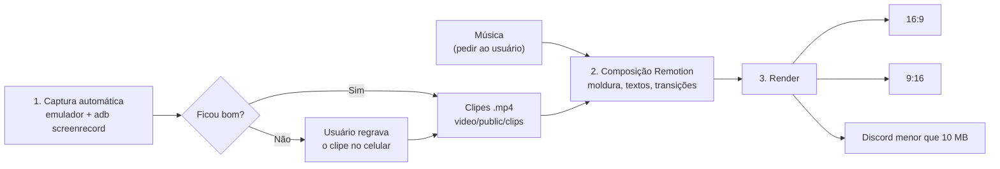
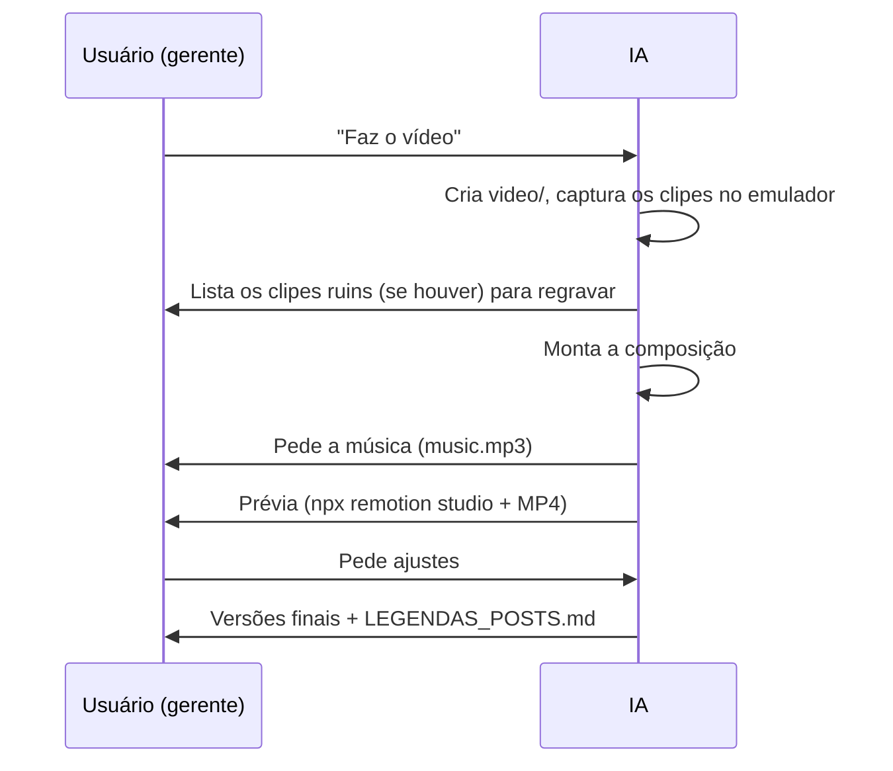

# 🎬 Plano: Vídeo Promocional do Ordo Companion (APK)

> **Status**: ✅ **CONCLUÍDO — Projeto `video/` (Remotion) implementado e renderizado (aguardando apenas `video/public/music.mp3` opcional do usuário)**
> **Criado em**: 2026-11-07
> **Gatilhos para retomar**: "faz o vídeo", "vídeo promocional", "vídeo do apk", "vídeo para o LinkedIn/Discord", "executa o plano do vídeo".

> [!IMPORTANT]
> **Instruções para o agente de IA que retomar esta pendência**:
> 1. Este plano **já foi aprovado** pelo usuário. Não replaneje do zero: execute seguindo as seções abaixo.
> 2. Antes de começar, confira se o roteiro ainda bate com o app atual (telas em `src/app/(tabs)/`) e quais bugs seguem abertos em `docs/imagensDosProblemas/`. **Nunca mostre recursos com bug no vídeo.**
> 3. **Peça a música ao usuário** quando chegar a etapa de áudio (ver seção "Música"). Não baixe faixas por conta própria.
> 4. O usuário atua como **gerente**: ele só aprova, revisa e pede ajustes. Toda a produção é responsabilidade da IA.
> 5. Ao concluir, mude o Status deste arquivo para ✅ CONCLUÍDO e atualize a governança (`ATUALIZACOES_PENDENTES.md` e `COMMITS_PENDENTES.md`).

---

## 1. Objetivo

Produzir um vídeo curto (~45s), bonito, com música, textos animados e mensagem final, mostrando o APK do Ordo Companion para divulgar no **Discord, LinkedIn, Instagram, TikTok, YouTube e X**.

Metas do usuário:
1. Ficar relativamente bonito.
2. Ter música.
3. Ter um pouco de edição, com mensagens na tela.
4. O usuário não precisa produzir nada: ele só gerencia.

---

## 2. Decisões já tomadas pelo usuário ✅

| Tema | Decisão |
| :--- | :--- |
| **Ferramenta** | [Remotion](https://www.remotion.dev): vídeo como código em React + TypeScript, numa pasta isolada `video/` |
| **Link do CTA** | **GitHub Releases** (página de releases do repositório) |
| **Mensagens** | As **duas** frases aparecem ao longo do vídeo. A **frase de destaque (tela final)** é a do "feito por fã / open source" |
| **Captura das telas** | **Híbrida**: a IA grava automaticamente no emulador, e o usuário regrava manualmente só os clipes que não ficarem bons |
| **Música** | O usuário baixa a faixa **quando a IA pedir** (Pixabay Music, YouTube Audio Library ou Uppbeat) |
| **Idioma** | Português (uma versão em inglês para o LinkedIn pode vir depois, se pedirem) |
| **Duração** | ~45 segundos |

### Frases oficiais

- **Frase de destaque (tela final):** *"Feito por um fã, para a comunidade de Ordem Paranormal. Gratuito e open source."*
- **Frase de CTA (aparece no decorrer do vídeo e embaixo da final):** *"Baixe o APK gratuito → GitHub Releases"* + URL da página de releases do repositório (pegue de `git remote get-url origin` + `/releases/latest`).

---

## 3. Resultado final esperado

Arquivos em `video/out/`:

| Arquivo | Formato | Uso |
| :--- | :--- | :--- |
| `ordo-companion-16x9.mp4` | 1920×1080, 30fps, ~45s | LinkedIn, YouTube, X |
| `ordo-companion-9x16.mp4` | 1080×1920, 30fps, ~45s | Instagram Reels, TikTok, Shorts |
| `ordo-companion-discord.mp4` | 1280×720, comprimido **< 10 MB** | Discord (limite das contas sem Nitro) |
| `thumbnail.png` | 1920×1080 | Capa / prévia |
| `LEGENDAS_POSTS.md` | Texto | Legendas prontas para LinkedIn, Discord e Instagram |



---

## 4. Roteiro (storyboard ~45s)

Identidade visual: paleta do tema escuro em `src/theme/themes.ts` (fundo `#090A0F`, primária `#DC2626`, destaque `#A855F7`), efeito de glitch/estática da Ordem, celular em perspectiva 3D.

| # | Tempo | Cena | Texto animado |
| :--- | :--- | :--- | :--- |
| 1 | 0–4s | Tela preta, estática/glitch, o logo (`assets/icon.png`) surge | *"O Outro Lado está mais perto do que você imagina."* |
| 2 | 4–9s | Celular abrindo o app (tela inicial `index.tsx`) | **ORDO COMPANION**: *o grimório tático de Ordem Paranormal* |
| 3 | 9–16s | Compêndio (`books.tsx`): busca por um ritual e abertura do detalhe | *10 suplementos oficiais. Tudo na palma da mão.* |
| 4 | 16–23s | Agentes (`characters.tsx`): criação de ficha com PV/PE/SAN calculados | *Fichas com regras calculadas automaticamente* |
| 5 | 23–28s | Rolador de dados (`dice.tsx`) | *Rolagens oficiais, na hora* + CTA discreto no rodapé: *"Baixe grátis no GitHub Releases"* |
| 6 | 28–34s | Central do Mestre / Mesa (`master.tsx` / `table.tsx`) | *Ferramentas para o Mestre e mesa multiplayer* |
| 7 | 34–39s | Oráculo G.L.I.T.C.H. (`oracle.tsx`) com o **motor offline** | *Uma IA paranormal ao seu lado* |
| 8 | 39–45s | Logo + **frase de destaque** + CTA com link | *"Feito por um fã, para a comunidade de Ordem Paranormal. Gratuito e open source."* / *"Baixe o APK gratuito → GitHub Releases"* |

> [!WARNING]
> **Evitar no vídeo** (bugs abertos quando este plano foi escrito): leitor de PDF, microfone/botão ouvir, erros dos provedores Gemini e Groq, login Google. Antes de gravar, confira de novo `docs/imagensDosProblemas/`.

**Dados de demonstração**: crie uma ficha fictícia e bonita (ex.: *"Agente Arthur Cervero, Ocultista, NEX 35%"*) antes de gravar a cena 4.

---

## 5. Música (pedir ao usuário na hora certa)

Quando a composição visual estiver pronta, peça ao usuário:

> "Preciso da música agora. Baixe 1 faixa gratuita em **Pixabay Music**, **YouTube Audio Library** ou **Uppbeat** e salve em `video/public/music.mp3`. Termos de busca sugeridos: *dark cinematic trailer*, *horror tension*, *glitch dark synth*. O ideal é ter ~45–60s e um 'drop' por volta dos 4s."

Na composição: fade in de 1s, fade out de 2s e cortes de cena alinhados à batida (detectar o BPM ou ajustar à mão).

---

## 6. Estrutura técnica a criar

Tudo fica isolado em `video/`: **não mexe no código do app** e **não adiciona dependências** ao `package.json` raiz.

```
video/
├── package.json            # remotion, @remotion/cli, @remotion/transitions (ffmpeg já vem embutido)
├── tsconfig.json
├── README.md               # como re-renderizar, trocar textos e música
├── public/
│   ├── clips/              # clipes gravados (ignorado no git)
│   ├── icon.png            # cópia de assets/icon.png
│   └── music.mp3           # fornecido pelo usuário (ignorado no git)
├── scripts/
│   ├── capture.ps1         # captura automática no emulador
│   └── render.ps1          # render dos 3 formatos + thumbnail
├── src/
│   ├── index.ts
│   ├── Root.tsx            # composições Promo16x9, Promo9x16, Thumbnail
│   ├── Promo.tsx           # TransitionSeries com as 8 cenas + <Audio>
│   ├── copy.ts             # TODOS os textos/frases centralizados (fácil de editar)
│   └── components/
│       ├── PhoneFrame.tsx         # moldura de celular 3D + sombra
│       ├── AnimatedBackground.tsx # gradiente vermelho/roxo, partículas, estática
│       ├── GlitchText.tsx         # texto com efeito glitch
│       ├── CtaBadge.tsx           # selo "Baixe no GitHub Releases"
│       ├── EndCard.tsx            # logo + frase de destaque + CTA
│       └── theme.ts               # paleta copiada de src/theme/themes.ts
└── out/                    # vídeos renderizados (ignorado no git)
```

### Exemplo da composição

```tsx
<TransitionSeries>
  <TransitionSeries.Sequence durationInFrames={120}><IntroGlitch /></TransitionSeries.Sequence>
  <TransitionSeries.Transition presentation={fade()} timing={linearTiming({ durationInFrames: 15 })} />
  <TransitionSeries.Sequence durationInFrames={210}>
    <PhoneScene clip="clips/compendio.mp4" title={COPY.compendio} />
  </TransitionSeries.Sequence>
  {/* ... */}
</TransitionSeries>
<Audio src={staticFile('music.mp3')} volume={(f) => fadeInOut(f)} />
```

### Captura automática (`video/scripts/capture.ps1`)

Reaproveite a lógica de `scripts/iniciar_emulador_e_app.ps1` (AVD `Medium_Phone_API_37.0`, `adb` em `%LOCALAPPDATA%\Android\Sdk\platform-tools`).

```powershell
# Status bar limpa (modo demo)
adb shell settings put global sysui_demo_allowed 1
adb shell am broadcast -a com.android.systemui.demo -e command enter
adb shell am broadcast -a com.android.systemui.demo -e command clock -e hhmm 1200
adb shell am broadcast -a com.android.systemui.demo -e command battery -e level 100 -e plugged false
adb shell am broadcast -a com.android.systemui.demo -e command notifications -e visible false

# Para cada cena: inicia a gravação em paralelo, executa os toques roteirizados e baixa o clipe
adb shell screenrecord --bit-rate 12000000 --time-limit 12 /sdcard/compendio.mp4
adb shell input tap <x> <y> ; adb shell input text "ritual"
adb pull /sdcard/compendio.mp4 video/public/clips/
```

Dica: use `adb shell uiautomator dump` para descobrir as coordenadas dos botões em vez de chutar valores.

**Fallback híbrido**: se um clipe ficar ruim, passe ao usuário um roteiro curto de gravação manual (gravador de tela nativo do Android, ~10s, salvar em `video/public/clips/<nome>.mp4`).

### Render (`video/scripts/render.ps1`)

```powershell
npx remotion render Promo16x9 out/ordo-companion-16x9.mp4
npx remotion render Promo9x16 out/ordo-companion-9x16.mp4
npx remotion render Promo16x9 out/ordo-companion-discord.mp4 --scale=0.667 --crf=30
npx remotion still Thumbnail out/thumbnail.png
```

### Ajustes no repositório

- `.gitignore`: adicionar `video/node_modules/`, `video/out/`, `video/public/clips/` e `video/public/music.mp3`.
- `tsconfig.json` raiz: excluir `video/` se ele interferir no `npm run typecheck`.
- Governança: registrar em `docs/ATUALIZACOES_PENDENTES.md` (seção Docs/Tooling, **sem impacto na versão do app**) e em `docs/COMMITS_PENDENTES.md` (ex.: `chore(marketing): adiciona projeto remotion para video promocional`).

---

## 7. Fluxo com o usuário (gerente)



---

## 8. Verificação

### Automática
- `cd video && npx tsc --noEmit`
- Render dos 3 formatos sem erro; conferir que `ordo-companion-discord.mp4` tem **menos de 10 MB**
- `npm run typecheck` na raiz continua passando

### Manual (usuário)
- Assistir aos 3 vídeos: ritmo, legibilidade dos textos no celular, volume da música
- Conferir as frases e o link do GitHub Releases
- Testar o upload num canal de teste do Discord e num rascunho do LinkedIn
